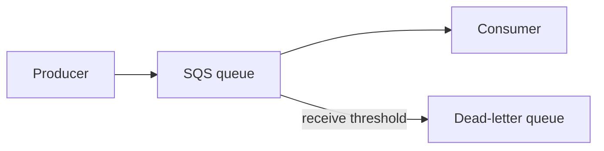

# Terraform SQS Resilient Queue
A reusable AWS module for a standard queue with a dead-letter queue, long polling,
server-side encryption, a transport-security policy, and restricted DLQ redrive sources.
Useful when a prototype queue needs explicit failure handling without a full platform stack.

## Architecture

Standard queues can deliver duplicates. Consumers must be idempotent and delete messages
only after successful processing. This module provisions queues, not producers or workers.

## No-account checks
Requires Terraform 1.7+ (provider mocking), AWS provider 6.x, and registry network access.
```bash
terraform init -backend=false
terraform fmt -check -recursive
terraform validate
terraform test
```
Tests mock AWS and do not contact an AWS account or deploy resources. They are contract
tests, not evidence of end-to-end delivery or AWS policy enforcement.
Commit the generated `.terraform.lock.hcl` after reviewing the selected provider version.

## Deploy to a sandbox AWS account
Uses your existing AWS credential chain; never put keys in source or tfvars.
```bash
cd examples/basic
aws sts get-caller-identity  # verify the account first
terraform init
terraform plan -out=queue.tfplan
terraform apply queue.tfplan
terraform output queue_url
```
Review the plan before applying. AWS usage charges may apply. There is no auto-apply workflow.
The example uses local state: for a team, configure an encrypted remote backend with locking
and access controls. State and saved plans may contain sensitive information; never commit them.

## Inputs and defaults
| Input | Default | Notes |
|---|---|---|
| name | required | 1–60 letters, digits, underscore, hyphen; standard queue only |
| visibility_timeout_seconds | 60 | Set above expected processing time; integer 0–43200 |
| max_receive_count | 5 | Integer 1–1000 |
| tags | {} | ManagedBy and Project tags are owned by the module |
Source retention is four days; DLQ retention is fourteen days; polling wait is twenty seconds.
`queue_url`, `queue_arn`, and `dead_letter_queue_url` are exported.

## Operational tradeoffs
- SQS-managed encryption avoids a customer KMS key, but does not provide custom-key controls.
- The explicit deny blocks non-TLS access; it does not grant producer or consumer access.
  Attach narrowly scoped IAM to your workload role separately.
- Redrive allow policy restricts which queue may use this DLQ; it is not an IAM consumer policy.
- No alerts are created: add CloudWatch monitoring for age of oldest message and DLQ depth
  before production use. No FIFO, VPC endpoint, cross-account access, or workload identity is configured.
- DLQ redrive is deliberately manual; investigate poison messages before replaying them.

## Cleanup
In `examples/basic`, run `terraform plan -destroy`, review it, then `terraform destroy`.
Deleting queues permanently loses their messages. Only do this in the dedicated sandbox.

## References
- https://registry.terraform.io/providers/hashicorp/aws/latest/docs/resources/sqs_queue
- https://registry.terraform.io/providers/hashicorp/aws/latest/docs/resources/sqs_queue_redrive_allow_policy
- https://developer.hashicorp.com/terraform/language/tests/mocking

MIT licensed. Suggested contribution: add alarm examples with a user-provided notification destination.
